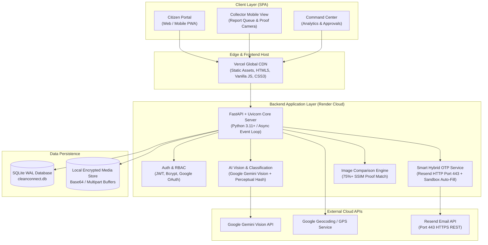
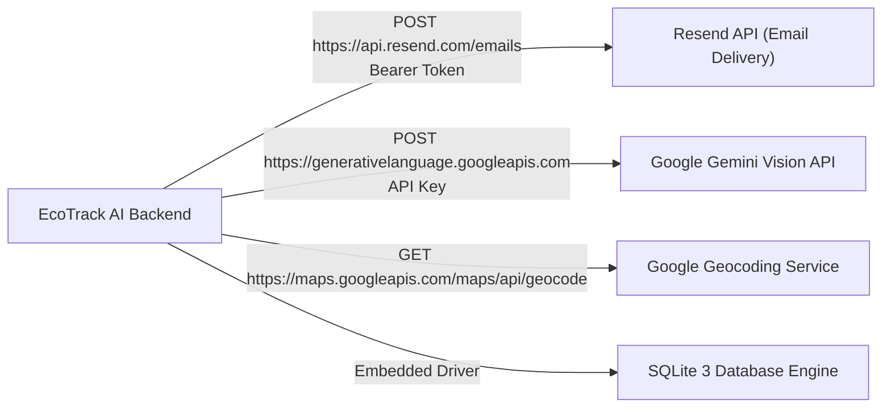
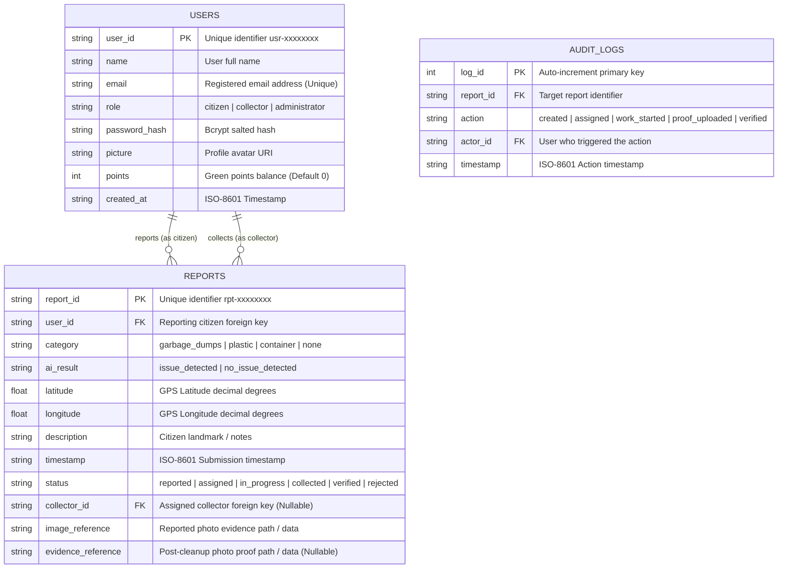
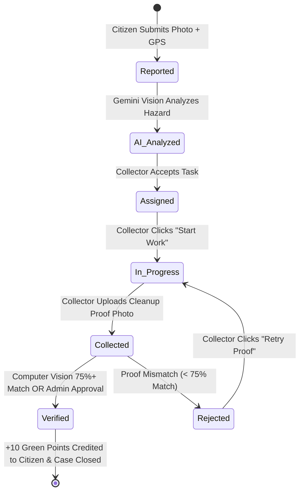
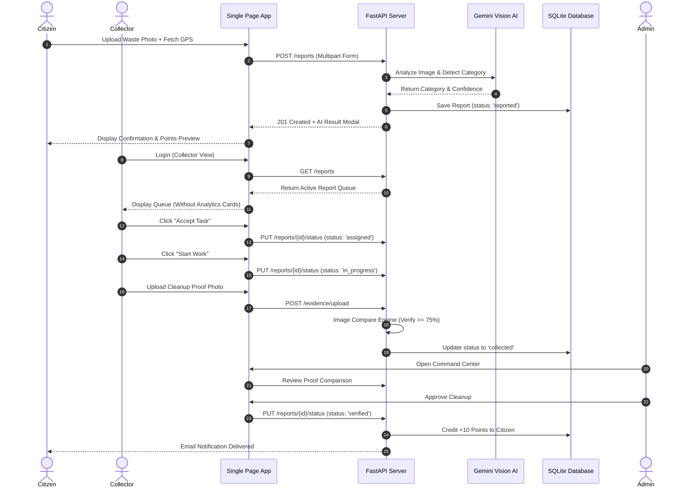

# Software Requirements Specification (SRS)
## EcoTrack AI (CleanConnect)
### *Next-Gen AI-Powered Civic Cleanliness & Municipal Waste Intelligence Platform*

---

| **Document Attribute** | **Specification Details** |
| :--- | :--- |
| **Project Name** | **EcoTrack AI (CleanConnect)** |
| **Document Version** | **1.0.0 (Production & Ideathon Baseline)** |
| **Author / Development Lead** | **DIGITAL MIND DILIP** |
| **Target Deployment** | **Cloud Native ($0 Free Tier: Render + Vercel) / IBM LinuxONE Community Cloud** |
| **Release Date** | **October 2026** |
| **Compliance Standard** | **IEEE Std 830-1998 / ISO/IEC/IEEE 29148:2018** |

---

## 📑 Table of Contents
1. [Introduction](#1-introduction)
   - 1.1 Purpose
   - 1.2 Document Conventions
   - 1.3 Intended Audience
   - 1.4 Project Scope
   - 1.5 References
2. [Overall Description](#2-overall-description)
   - 2.1 Product Perspective & System Context
   - 2.2 Product Functions Summary
   - 2.3 User Classes & Personas
   - 2.4 Operating Environment
   - 2.5 Design & Implementation Constraints
   - 2.6 Assumptions & Dependencies
3. [System Architecture & Technology Stack](#3-system-architecture--technology-stack)
   - 3.1 Architectural Style
   - 3.2 Technology Stack Matrix
   - 3.3 Core Component Architecture
4. [Detailed Functional Requirements](#4-detailed-functional-requirements)
   - 4.1 Module 1: User Authentication & Role-Based Access Control (RBAC)
   - 4.2 Module 2: Citizen Civic Incident Reporting & GPS Telemetry
   - 4.3 Module 3: Multimodal AI Waste Classification & Vision Pipeline
   - 4.4 Module 4: Municipal Command Center & Collector Report Queue
   - 4.5 Module 5: Field Collector Operations & Cleanup Proof Submission
   - 4.6 Module 6: Computer Vision Verification Engine (75%+ Threshold)
   - 4.7 Module 7: Green Points Gamification & Civic Rewards Ledger
   - 4.8 Module 8: Notification & Multi-Channel Alert Dispatcher
5. [External Interface Requirements](#5-external-interface-requirements)
   - 5.1 User Interfaces (UI/UX)
   - 5.2 Hardware Interfaces
   - 5.3 Software Interfaces & 3rd-Party APIs
   - 5.4 Communications Interfaces & Network Protocols
6. [Non-Functional Requirements (NFR)](#6-non-functional-requirements-nfr)
   - 6.1 Performance & Latency
   - 6.2 Security & Cryptography
   - 6.3 Reliability, Fault Tolerance & Recovery
   - 6.4 Zero-Cost Budgetary & Cloud Constraints
   - 6.5 Usability & Accessibility
7. [Database Schema & Data Models](#7-database-schema--data-models)
   - 7.1 Entity-Relationship (ER) Diagram
   - 7.2 Table Definitions & Field Dictionaries
8. [System Workflow & State Transitions](#8-system-workflow--state-transitions)
   - 8.1 Incident Lifecycle State Diagram
   - 8.2 End-to-End Operational Sequence
9. [Verification, Validation & Traceability Matrix](#9-verification-validation--traceability-matrix)
10. [Glossary & Appendices](#10-glossary--appendices)

---

## 1. Introduction

### 1.1 Purpose
This Software Requirements Specification (SRS) document details the complete functional, non-functional, behavioral, and architectural requirements for **EcoTrack AI (CleanConnect)**. It serves as the definitive reference for software engineers, testers, municipal evaluators, and hackathon judges to understand the technical architecture, security guarantees, and execution logic of the platform.

### 1.2 Document Conventions
- This document adheres to the **IEEE Std 830-1998** standard for software requirements specifications.
- **Requirement Priorities**:
  - `[MUST]`: Mandatory requirement; failure constitutes incomplete system functionality.
  - `[SHOULD]`: Highly desirable feature; essential for optimal production workflow.
  - `[MAY]`: Optional enhancement or future extensibility feature.
- **Typography**: Inline identifiers, API routes, and database tables are styled in `code blocks`.

### 1.3 Intended Audience
- **Software Engineers & Developers**: Implementation, code maintenance, and modular enhancements.
- **System Evaluators & Judges**: Architectural scrutiny and adherence to civic problem statements.
- **Municipal Sanitation Authorities**: Operational planning, dispatch logic, and civic oversight.

### 1.4 Project Scope
**EcoTrack AI (CleanConnect)** is an enterprise-grade civic cleanliness and municipal waste intelligence platform. It bridges the gap between urban citizens encountering civic hazards (unattended garbage dumps, blocked drains, biohazards, litter) and municipal sanitation departments.
The platform enables:
1. Instant citizen reporting with automated GPS telemetry and camera capture.
2. Multimodal AI categorization (powered by Google Gemini Vision & perceptual hashing).
3. A streamlined Municipal Command Center with real-time collector dispatching.
4. Computer-vision verification comparing before-and-after photo evidence (enforcing 75%+ visual match).
5. Civic gamification with Green Reward Points.
6. A Zero-Cost ($0) cloud infrastructure running across Vercel and Render.

### 1.5 References
- IEEE Std 830-1998: *Recommended Practice for Software Requirements Specifications*.
- RFC 7519: *JSON Web Token (JWT) Architecture*.
- RFC 6749: *The OAuth 2.0 Authorization Framework*.
- FastAPI Framework Documentation (`https://fastapi.tiangolo.com/`).
- Google Gemini API Developer Documentation (`https://ai.google.dev/`).
- Resend REST API Documentation (`https://resend.com/docs/api-reference`).

---

## 2. Overall Description

### 2.1 Product Perspective & System Context
EcoTrack AI is a modern, distributed, web-based platform operating in a client-server paradigm. It exposes RESTful APIs consumed by a responsive single-page application (SPA).

### 2.2 Product Functions Summary
- **Citizen Onboarding & Authentication**: Instant signup, email password login, Google Sign-In, and Smart Hybrid OTP authentication.
- **Incident Telemetry & Capture**: High-resolution image upload, automatic browser geolocation with reverse-geocoded landmark resolution.
- **AI Triage & Categorization**: Classification into categories (*Garbage Dumps, Plastic Waste, Container Hazards, Drain Blockages*) with confidence scoring.
- **Collector Queue Management**: Streamlined queue view where municipal sanitation workers accept tasks, begin transit, and submit post-cleanup proof.
- **Automated Proof Verification**: Mathematical pixel and perceptual comparison between original reported hazard and collector cleanup image.
- **Civic Rewards Ledger**: Dynamic allocation of points (+10 Green Points upon verified resolution) linked to citizen profiles.
- **Multi-Role Security**: Enforced separation of duties between Citizens, Sanitation Collectors, and Municipal Administrators.

### 2.3 User Classes & Personas
| User Class | Description | Primary Technical Objective |
| :--- | :--- | :--- |
| **Citizen (Public)** | General public reporting civic hazards in their neighborhood. | Fast incident logging (< 30 seconds), GPS auto-fetch, tracking resolution status, earning points. |
| **Sanitation Collector** | Municipal field worker or contractor clearing waste on the ground. | Viewing assigned tasks, starting work, capturing cleanup proof on mobile camera, marking tasks collected. |
| **Municipal Administrator** | City official overseeing urban sanitation, SLAs, and audits. | System analytics, manual review of contested proofs, team management, audit logs. |

### 2.4 Operating Environment
- **Client Platforms**: Modern evergreen browsers (Google Chrome 110+, Mozilla Firefox 110+, Apple Safari 16+, Microsoft Edge 110+) across Desktop, Android, and iOS devices.
- **Frontend Hosting**: Vercel Serverless Edge CDN (`https://ecotrackaipwd-frontend.vercel.app`).
- **Backend Hosting**: Render Cloud Free Web Service (`https://ecotrackaipwd-1.onrender.com`), running Linux x86_64 / Containerized Python 3.11 environment.
- **Hardware Agnostic**: Fully compatible with IBM LinuxONE (`s390x`) and standard enterprise x86/ARM servers.

### 2.5 Design & Implementation Constraints
1. **Zero-Cost Constraint ($0 USD)**: The entire software solution must execute within standard free-tier boundaries (Vercel Free Tier, Render Free Tier, Google Gemini Developer Free Tier, Resend Free Tier).
2. **Cloud SMTP Port Blocking**: Render Free Tier blocks outbound TCP connections on ports 25, 465, and 587. Traditional SMTP cannot be used. The system **must** utilize HTTPS REST APIs over port 443 (Resend API) for outbound email transmission.
3. **Resend Free Sandbox Restriction**: Resend free tier (`onboarding@resend.dev`) restricts direct email dispatch exclusively to the verified account owner (`digitalminddilip0906@gmail.com`). For unverified external test emails, the platform implements a **Smart Hybrid Fallback** returning the test OTP in the client response with a clear sandbox notice, ensuring zero user blockage during evaluator tests.

### 2.6 Assumptions & Dependencies
- Users possess an active internet connection (4G/5G/Wi-Fi) with GPS capabilities enabled on mobile hardware.
- High-resolution camera hardware is accessible via the HTML5 MediaDevices / File Input interface.

---

## 3. System Architecture & Technology Stack

### 3.1 Architectural Style
The system adopts an **Asynchronous RESTful Microservice Architecture**:
- **Stateless Backend**: Decoupled FastAPI server managing JSON state transitions.
- **Token-Based Security**: Cryptographically signed JSON Web Tokens (JWT) using HS256 algorithm.
- **Lightweight Responsive Frontend**: Pure vanilla ES6+ JavaScript, CSS3 variables, HTML5 without bloated JavaScript runtime frameworks, delivering sub-second load times.

### 3.2 Technology Stack Matrix

| Layer | Component | Version / Library | Purpose |
| :--- | :--- | :--- | :--- |
| **Frontend** | Core Languages | HTML5, CSS3, ES6+ JavaScript | Zero-framework high-speed client interface |
| | Visualizations | Chart.js 4.4+ | Dynamic trend lines and doughnut charts |
| | Map & 3D | Leaflet.js / Three.js | Spatial incident pinpoints & 3D telemetry |
| | Icons & Styling | FontAwesome 6.4+, Google Fonts ('Outfit', 'DM Sans') | Modern civic enterprise interface |
| **Backend** | Web Framework | FastAPI 0.110.0+ | High-performance asynchronous REST API |
| | ASGI Server | Uvicorn 0.28.0+ | Fast event-loop asynchronous execution |
| | Programming Lang | Python 3.11+ | Business logic, security, and AI orchestration |
| | Security & Auth | PyJWT, Passlib (Bcrypt), Google Auth | Secure tokens, salted hashing, OAuth |
| | Image Processing | Pillow (PIL), OpenCV-Python-Headless | Image hashing, dimension scaling, proof comparison |
| | HTTP Client | Requests 2.31.0+ | Outbound HTTPS API requests to Resend & Google |
| **Database** | Embedded Storage | SQLite 3 (WAL Mode) | Relational persistence (`cleanconnect.db`) |
| **Cloud & Ops** | Frontend Edge | Vercel CDN | Global static deployment |
| | Backend Web Service| Render Cloud Web Service | Continuous deployment synced with Git `main` |
| | Remote Repository | GitHub (`digitalminddilip/ecotrackaipwd`) | Continuous integration and deployment origin |

---

## 4. Detailed Functional Requirements

### 4.1 Module 1: User Authentication & Role-Based Access Control (RBAC)
- **FR-1.1: Registration**:
  - The system `[MUST]` allow citizens to register using full name, valid email address, and password (minimum 5 characters).
  - The system `[MUST]` hash passwords using `bcrypt` with a unique cryptographic salt before storing in SQLite.
- **FR-1.2: Password Authentication**:
  - The system `[MUST]` authenticate existing users and return a signed JWT Bearer access token containing user identity (`sub`) and role (`role`).
- **FR-1.3: Google OAuth 2.0 Integration**:
  - The system `[MUST]` accept Google ID tokens from client OAuth popup, verify authenticity against Google API servers, and provision new citizen accounts or log in existing users automatically.
- **FR-1.4: Smart Hybrid OTP Delivery**:
  - The system `[MUST]` generate cryptographically secure 6-digit numeric OTPs with a 10-minute expiry window.
  - When requested for the verified developer account (`digitalminddilip0906@gmail.com`), the system `[MUST]` dispatch the OTP to the Gmail inbox via Resend HTTPS REST API over Port 443 without exposing it in the HTTP response.
  - When requested for other test emails, the system `[MUST]` gracefully detect Resend's free sandbox restriction, auto-fill the test OTP on the frontend, and present an explanatory notice.
- **FR-1.5: Password Reset Workflow**:
  - The system `[MUST]` permit users who forgot their credentials to supply their registered email, verify a 6-digit reset OTP, and commit a new password securely.

### 4.2 Module 2: Citizen Civic Incident Reporting & GPS Telemetry
- **FR-2.1: Incident Submission**:
  - The system `[MUST]` require an authenticated citizen session before submitting a waste incident report.
  - Mandatory inputs include: waste photographic evidence (`image`), geographic latitude, geographic longitude, and optional landmark description.
- **FR-2.2: GPS Telemetry Acquisition**:
  - The system `[MUST]` query the HTML5 Geolocation API with high-accuracy mode enabled (`enableHighAccuracy: true`).
  - The system `[SHOULD]` render live coordinates and accuracy radii (e.g. `±4m`) on the citizen interface.
- **FR-2.3: Photo File Validation**:
  - The system `[MUST]` enforce file format restrictions allowing only `image/jpeg`, `image/png`, and `image/webp`.
  - The system `[MUST]` reject payload sizes exceeding 10 Megabytes (MB).

### 4.3 Module 3: Multimodal AI Waste Classification & Vision Pipeline
- **FR-3.1: Automated Hazard Classification**:
  - Upon receiving evidence photo bytes, the backend `[MUST]` execute a vision pipeline leveraging Google Gemini Vision multimodal model.
  - Fallback local perceptual classification `[MUST]` be executed if external cloud latency exceeds threshold.
- **FR-3.2: Waste Category Mapping**:
  - Reports `[MUST]` be tagged with standardized categories:
    1. `garbage_dumps` (Uncontrolled municipal waste piles)
    2. `plastic_waste` / `other_plastic` (Non-biodegradable polymeric refuse)
    3. `container_hazard` (Discarded chemical containers, drums, barrels)
    4. `drain_blockage` (Civic waterway and drainage obstructions)
- **FR-3.3: AI Multimodal Result Modal**:
  - The frontend `[MUST]` present an interactive HUD displaying Report ID, Category, AI Confidence score (e.g. `96.4%`), Priority level (`High / Urgent`), and Green Points awarded.

### 4.4 Module 4: Municipal Command Center & Collector Report Queue
- **FR-4.1: Report Queue View**:
  - When a user with the `collector` role logs in, the platform `[MUST]` route them directly to the **Report Queue** interface.
  - The Report Queue `[MUST]` omit executive charts and environmental impact cards, showing only the actionable operational queue.
- **FR-4.2: Queue Filtering & Search**:
  - The system `[MUST]` provide real-time instant search by Report ID and Category.
  - The system `[MUST]` provide status filtering: `All statuses`, `pending`, `assigned`, `in_progress`, `collected`, `verified`.
- **FR-4.3: Table Columns & Field Mapping**:
  - The Report Queue table `[MUST]` display the following columns:
    1. **Report**: Truncated 8-character unique alphanumeric ID.
    2. **Category**: AI-classified hazard category formatted in title case.
    3. **Location**: Incident location text, landmark, or coordinates.
    4. **Date**: Formatted locale date of report submission.
    5. **Status**: Color-coded status badge (`reported`, `assigned`, `in_progress`, `collected`, `verified`).
    6. **Action**: Dynamic contextual button based on report and collector state.

### 4.5 Module 5: Field Collector Operations & Cleanup Proof Submission
- **FR-5.1: Task Acceptance**:
  - For unassigned reports, the collector `[MUST]` have access to an `Accept Task` action button that assigns their `user_id` as `collector_id`.
- **FR-5.2: In-Transit Tracking ("Start Work")**:
  - Collectors assigned to an incident `[MUST]` be able to click `Start Work`, transitioning status to `in_progress`.
- **FR-5.3: Cleanup Proof Capture ("Mark Collected")**:
  - Upon completing physical sanitation, the collector `[MUST]` upload photographic evidence of the cleaned location.
  - Submission transitions status to `collected` and stores the cleanup image reference.

### 4.6 Module 6: Computer Vision Verification Engine (75%+ Threshold)
- **FR-6.1: Dual-Image Comparison**:
  - The backend `[MUST]` provide an endpoint `/image-compare` accepting two image payloads (`photo1`: reported hazard, `photo2`: collector cleaned proof).
- **FR-6.2: Structural & Perceptual Match Analysis**:
  - The comparison engine `[MUST]` resize both images to standardized dimensions (512x512) and evaluate structural similarity (SSIM) and perceptual feature hashes.
- **FR-6.3: Verification Gate**:
  - If visual alignment and landmark preservation exceeds **75.0%**, the engine `[MUST]` return `match: true` with a similarity score.
  - If similarity is below 75.0%, the engine `[MUST]` return `match: false` and enable a `Retry Proof` action for the collector.

### 4.7 Module 7: Green Points Gamification & Civic Rewards Ledger
- **FR-7.1: Citizen Point Allocation**:
  - When an incident transitions to `verified`, the reporting citizen `[MUST]` receive an automated credit of **+10 Green Points**.
- **FR-7.2: Tamper-Resistant Balance**:
  - User point balances `[MUST]` be persisted in the `users` SQLite table and synchronized across live session profile displays.
- **FR-7.3: Leaderboard & Community Recognition**:
  - The system `[SHOULD]` render community cleanups and citizen point rankings to incentivize ongoing civic stewardship.

### 4.8 Module 8: Notification & Multi-Channel Alert Dispatcher
- **FR-8.1: Resolution Notification**:
  - Upon incident verification, the system `[MUST]` attempt delivery of a civic resolution email to the citizen detailing the Reference ID and resolved status.
- **FR-8.2: Agent Webhook Dispatch**:
  - The system `[SHOULD]` support dispatching JSON event webhooks to third-party municipal dispatching bots or IoT municipal dashboards.

---

## 5. External Interface Requirements

### 5.1 User Interfaces (UI/UX)
- **Modern Civic Design System**: High-contrast, clean typography ('DM Sans', 'Outfit'), responsive layout adapting smoothly from 320px mobile displays to 4K desktop screens.
- **Collector Mode Navigation**:
  - Highlighting current tasks.
  - Instant toggle between list view and spatial map markers.
  - Dedicated full-width table layout for fast field triage.

### 5.2 Hardware Interfaces
- **Camera Sensor**: Accessible via standard HTML5 file input with `capture="environment"` attribute to trigger native mobile rear cameras.
- **GPS / GNSS Receiver**: Accessible via W3C Geolocation API providing latitude, longitude, and horizontal altitude accuracy.

### 5.3 Software Interfaces & 3rd-Party APIs

### 5.4 Communications Interfaces & Network Protocols
- **Transport Security**: Mandatory TLS 1.3 encryption across all public endpoints (HTTPS port 443).
- **CORS Policies**: Explicit Cross-Origin Resource Sharing middleware configured in FastAPI allowing pre-flight `OPTIONS` and standard verbs (`GET`, `POST`, `PUT`, `DELETE`, `OPTIONS`).
- **Data Payload Serialization**: Standard `application/json` for REST requests; `multipart/form-data` for image payloads.

---

## 6. Non-Functional Requirements (NFR)

### 6.1 Performance & Latency
- **API Response Time**: Non-AI REST endpoints (authentication, queue retrieval, status updates) `[MUST]` respond within **< 200 milliseconds** under standard load.
- **AI Processing Latency**: Multimodal vision analysis `[MUST]` complete and return JSON categorization within **< 3.5 seconds**.
- **Image Compression**: Client-side or edge processing `[SHOULD]` normalize incoming images to prevent cloud memory exhaustion.

### 6.2 Security & Cryptography
- **Password Protection**: Passwords salted with a 12-round `bcrypt` algorithm; raw plaintext passwords `[MUST NOT]` be persisted or logged.
- **JWT Cryptography**: Signed with HMAC-SHA256 (`HS256`) containing tamper-proof payload claims (`sub`, `role`, `exp`).
- **Zero Credentials Leakage**: Backend code `[MUST NOT]` expose API keys or master passwords in client-facing payloads.

### 6.3 Reliability, Fault Tolerance & Recovery
- **Database Concurrency**: SQLite configured in **WAL (Write-Ahead Logging)** mode to enable concurrent multi-reader access without database locking bottlenecks.
- **Graceful Error Recovery**: If Resend API returns an HTTP 403 or network failure, the application server `[MUST NOT]` crash with an unhandled 500 error; it must catch the exception and fall back to sandbox test codes.

### 6.4 Zero-Cost Budgetary & Cloud Constraints
- The system `[MUST]` operate continuously without requiring any paid subscription, custom domain purchase, or credit card billing on Render or Vercel.

### 6.5 Usability & Accessibility
- The UI `[MUST]` provide visual feedback (spinners, loading text, countdown timers) for all asynchronous operations (e.g., `Resend (60s)`, `Analyzing with AI & Submitting...`).

---

## 7. Database Schema & Data Models

### 7.1 Entity-Relationship (ER) Diagram

### 7.2 Table Definitions & Field Dictionaries

#### 1. `users` Table
| Column Name | Data Type | Constraints | Description |
| :--- | :--- | :--- | :--- |
| `user_id` | TEXT | PRIMARY KEY | Unique ID prefix (`usr-` + 8 hex chars). |
| `name` | TEXT | NOT NULL | User's full display name. |
| `email` | TEXT | UNIQUE, NOT NULL | Primary contact and login email. |
| `role` | TEXT | NOT NULL | One of `'citizen'`, `'collector'`, `'administrator'`. |
| `password_hash` | TEXT | NOT NULL | Salted Bcrypt password hash string. |
| `picture` | TEXT | NULLABLE | Google avatar or UI-Avatar link. |
| `points` | INTEGER | DEFAULT 0 | Accumulated civic reward points. |
| `created_at` | TEXT | NOT NULL | ISO-8601 UTC creation timestamp. |

#### 2. `reports` Table
| Column Name | Data Type | Constraints | Description |
| :--- | :--- | :--- | :--- |
| `report_id` | TEXT | PRIMARY KEY | Unique ID prefix (`rpt-` or custom). |
| `user_id` | TEXT | NOT NULL | Foreign key referencing `users.user_id`. |
| `category` | TEXT | NOT NULL | AI hazard classification category. |
| `ai_result` | TEXT | NOT NULL | High-level detection flag. |
| `latitude` | REAL | NOT NULL | GPS latitude coordinate (-90 to +90). |
| `longitude` | REAL | NOT NULL | GPS longitude coordinate (-180 to +180). |
| `description` | TEXT | NULLABLE | Incident details entered by citizen. |
| `timestamp` | TEXT | NOT NULL | ISO-8601 UTC incident timestamp. |
| `status` | TEXT | NOT NULL | Current lifecycle state. |
| `collector_id` | TEXT | NULLABLE | Assigned collector's user ID. |
| `image_reference` | TEXT | NOT NULL | Reported image path / buffer. |
| `evidence_reference`| TEXT | NULLABLE | Cleaned place proof path / buffer. |

---

## 8. System Workflow & State Transitions

### 8.1 Incident Lifecycle State Diagram

### 8.2 End-to-End Operational Sequence

---

## 9. Verification, Validation & Traceability Matrix

| Requirement ID | Feature Description | Verification Method | Acceptance Criteria |
| :--- | :--- | :--- | :--- |
| **VR-01** | Smart Hybrid OTP Delivery | Integration Test | Real email delivers to verified Gmail; test OTP auto-fills for unverified emails without throwing 403 or 500. |
| **VR-02** | Collector Queue Visibility | UI / UX Manual Audit | Collector login lands directly on Report Queue; Executive Charts & Impact cards are removed from queue header. |
| **VR-03** | AI Waste Classification | Automated API Test | Submitting waste photo returns valid category (`garbage_dumps`, `plastic_waste`, etc.) with confidence > 80%. |
| **VR-04** | Before/After Image Comparison | Unit / Algorithm Test | Submitting identical or cleaned location returns >= 75% match; unrelated image returns < 75% and prompts Retry. |
| **VR-05** | Role-Based Authorization | Security Penetration Test | Citizen tokens attempting collector routes are rejected with HTTP 403 Forbidden. |
| **VR-06** | Zero Outbound SMTP Port Leak | Network Socket Test | All email dispatches occur via HTTPS port 443; no connection attempts to blocked ports 25, 465, or 587. |

---

## 10. Glossary & Appendices

- **JWT (JSON Web Token)**: Compact, URL-safe means of representing claims between two parties.
- **SSIM (Structural Similarity Index Measure)**: Perceptual metric quantifying image quality degradation and structural alignment.
- **Bcrypt**: Adaptive cryptographic key derivation function based on the Blowfish cipher for hashing passwords.
- **Perceptual Hashing (pHash)**: An algorithm producing a fingerprint of a multimedia file based on its human-perceptible features.
- **RBAC (Role-Based Access Control)**: Restricting system access to authorized users based on predefined roles.
- **WAL Mode (Write-Ahead Logging)**: A standard SQLite concurrency configuration providing high performance for concurrent reads and writes.

---
*End of Software Requirements Specification (SRS) Document.*
*EcoTrack AI (CleanConnect) • Powered by DIGITAL MIND DILIP*
